<h1 align="center">StockPilot — Inventory Management</h1>

<p align="center"><b>DevSecOps Final Capstone</b> · a small inventory app shipped through a complete, monitored delivery path to AWS EKS</p>

<p align="center">
  <a href="https://github.com/Gaurakumar-s/invenpilot-devsecops/actions/workflows/ci-cd.yml"></a>
  
  
  
  
  
  
  
  
  
  
  
  
</p>

<p align="center">
  <b>▶ <a href="https://gaurakumar-s.github.io/invenpilot-devsecops/demo/">Demo video (6 min 19 s)</a></b> &nbsp;·&nbsp;
  <b><a href="demo/slides.pdf">Slide deck (PDF, 14 pages)</a></b> &nbsp;·&nbsp;
  <b><a href="docs/screenshots/README.md">Evidence screenshots</a></b>
</p>

<p align="center">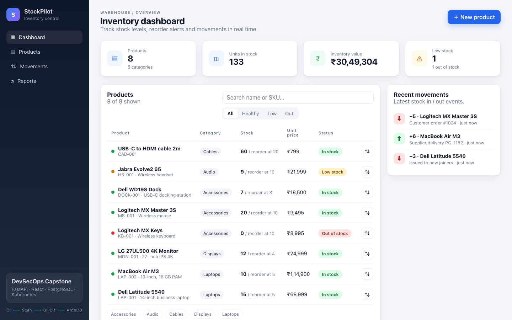<br><sub>StockPilot running on AWS EKS, reached through the ingress-nginx load balancer</sub></p>

| | |
|---|---|
| **Demo video (6 min 19 s)** | **[Watch in the browser](https://gaurakumar-s.github.io/invenpilot-devsecops/demo/)**: narrated walkthrough of slides, codebase, a live pipeline run, Trivy, Terraform + AWS console, ArgoCD, Kubernetes, Prometheus and Grafana (the file is [`demo/presentation.mp4`](demo/presentation.mp4)) |
| **Slide deck (14 pages)** | [`demo/slides.pdf`](demo/slides.pdf) · [`demo/slides.pptx`](demo/slides.pptx): overview, stack, architecture, CI/CD, security, Terraform, Kubernetes/Helm/ArgoCD, observability, learnings, plus four evidence pages |
| **Every rubric item and its screenshot** | [`docs/screenshots/README.md`](docs/screenshots/README.md) |

StockPilot is a small but production-shaped **inventory management** application. A warehouse team can
register products (SKU, category, quantity, reorder level, unit price), record **stock IN / OUT
movements**, and see **low-stock and out-of-stock alerts** plus KPI cards on a live dashboard.

The application is the vehicle; the real deliverable is the complete DevSecOps path from a laptop to a
monitored Kubernetes cluster on AWS:

```text
 Developer ──git push──▶ GitHub ──▶ GitHub Actions
                                     ├─ ruff + pytest (quality gate)
                                     ├─ npm build (frontend)
                                     ├─ docker build  backend + frontend
                                     ├─ Trivy scan    (HIGH/CRITICAL ⇒ fail)
                                     ├─ push  ghcr.io/…:<git-sha>
                                     └─ commit new tag into helm/ values  (GitOps)
                                                     │
                 Terraform ──▶ AWS VPC + EKS         ▼
                                   │             ArgoCD (auto-sync)
                                   ▼                 │
                        ┌──────── namespace: stockpilot ────────┐
                        │ Ingress  /  ──▶ frontend (Nginx) ×2   │
                        │          /api ▶ backend (FastAPI) ×2  │──▶ PostgreSQL (PVC)
                        │                  HPA 2→6              │
                        └────────────────┬──────────────────────┘
                                   /metrics  (ServiceMonitor)
                                         ▼
                                 Prometheus ──▶ Grafana
```

---

## Table of contents

1. [Features & API](#1-features--api)
2. [Tech stack](#2-tech-stack)
3. [Repository layout](#3-repository-layout)
4. [Local setup — Docker Compose](#4-local-setup--docker-compose)
5. [Running tests](#5-running-tests)
6. [CI/CD pipeline](#6-cicd-pipeline)
7. [Security scanning (Trivy)](#7-security-scanning-trivy)
8. [Infrastructure — Terraform on AWS](#8-infrastructure--terraform-on-aws)
9. [Kubernetes — Helm + ArgoCD](#9-kubernetes--helm--argocd)
10. [Observability — Prometheus + Grafana](#10-observability--prometheus--grafana)
11. [Demo & screenshots](#11-demo--screenshots)
12. [Known issues & limitations](#12-known-issues--limitations)

---

## 1. Features & API

| Area | Details |
|---|---|
| Products | Create / read / update / delete, search by name or SKU, filter by category |
| Stock movements | `IN` / `OUT` ledger per product; `OUT` cannot exceed available stock (HTTP 400) |
| Alerts | `low_stock` flag (quantity ≤ reorder level), out-of-stock count |
| Dashboard | KPI cards (products, units, inventory value, low stock), product table, movement feed |
| Ops endpoints | `/health` (liveness), `/ready` (DB check), `/metrics` (Prometheus), `/docs` (Swagger) |

### REST endpoints (FastAPI)

| Method | Path | Purpose |
|---|---|---|
| GET | `/api/products` | List products (`?category=`, `?search=`) |
| GET | `/api/products/{id}` | Get one product |
| POST | `/api/products` | Create product (201, 409 on duplicate SKU) |
| PUT | `/api/products/{id}` | Update product |
| DELETE | `/api/products/{id}` | Delete product (204) |
| GET | `/api/products/stats` | KPI aggregates |
| GET | `/api/products/low-stock` | Products at/below reorder level |
| POST | `/api/products/{id}/movements` | Record stock IN/OUT |
| GET | `/api/movements` | Latest movements (`?limit=`) |
| GET | `/health` · `/ready` · `/metrics` | Liveness · readiness · Prometheus metrics |

### Database (PostgreSQL 16, Alembic-managed)

* `products` — `0001_create_products`
* `stock_movements` — `0002_create_stock_movements` (FK → products, cascade delete)

Migrations run automatically on container start (`alembic upgrade head && uvicorn …`).

---

## 2. Tech stack

| Layer | Technology |
|---|---|
| Frontend | React 18, Vite 5, plain CSS (responsive, mobile sidebar), served by **Nginx (unprivileged)** |
| Backend | Python 3.12, **FastAPI**, SQLAlchemy 2, Pydantic 2, Alembic, psycopg 3, prometheus-fastapi-instrumentator |
| Database | PostgreSQL 16 |
| Testing / quality | pytest (20 tests, in-memory SQLite), ruff |
| Containers | Docker multi-stage builds, non-root users, Docker Compose |
| CI/CD | GitHub Actions, GitHub Container Registry (GHCR), commit-SHA image tags |
| Security | Trivy (OS + library CVEs, fails on HIGH/CRITICAL), least-privilege `GITHUB_TOKEN`, no secrets in git |
| Infrastructure | Terraform ≥ 1.7, AWS VPC (2 public + 2 private subnets, NAT), **EKS** managed node group, EBS CSI driver |
| Orchestration | Kubernetes, **Helm** chart, ingress-nginx, HPA, **ArgoCD** (GitOps) |
| Observability | kube-prometheus-stack (Prometheus Operator, Grafana), ServiceMonitor, custom dashboard |

---

## 3. Repository layout

```text
.
├── backend/                 FastAPI app
│   ├── app/                 main.py, config.py, db.py, models.py, schemas.py, routers/
│   ├── alembic/versions/    0001_create_products.py, 0002_create_stock_movements.py
│   ├── tests/               conftest.py + 20 tests (health, products, movements)
│   ├── Dockerfile           python:3.12-slim, non-root uid 10001
│   └── requirements.txt
├── frontend/                React + Vite dashboard
│   ├── src/                 App.jsx, api.js, components/
│   ├── nginx.conf           serves SPA, proxies /api → backend
│   └── Dockerfile           node:22-alpine build → nginx-unprivileged runtime
├── docker-compose.yml       postgres + backend + frontend (http://localhost:3000)
├── .github/workflows/       ci-cd.yml
├── terraform/               AWS VPC + EKS (+ EBS CSI IRSA), terraform.tfvars.example
├── k8s/                     namespace.yaml
├── helm/stockpilot/         Chart.yaml, values*.yaml, templates/
├── argocd/                  Application manifests + install.sh
├── monitoring/              kube-prometheus-stack values, Grafana dashboard JSON, install.sh
├── scripts/                 seed.sh, load-test.sh, eks-bootstrap.sh, minikube-bootstrap.sh
├── docs/screenshots/        evidence for every rubric module
└── demo/                    slides.pptx / slides.pdf and presentation video
```

---

## 4. Local setup — Docker Compose

Prerequisites: Docker Desktop (or Docker Engine + Compose v2).

```bash
git clone https://github.com/Gaurakumar-s/invenpilot-devsecops.git
cd invenpilot-devsecops
docker compose up --build
```

| URL | What |
|---|---|
| http://localhost:3000 | StockPilot dashboard |
| http://localhost:8000/docs | Swagger UI |
| http://localhost:8000/health · `/ready` · `/metrics` | Ops endpoints |

Seed demo data and stop:

```bash
./scripts/seed.sh http://localhost:8000
docker compose down        # add -v to drop the database volume
```

Compose starts PostgreSQL with a healthcheck; the backend waits for it to be healthy, runs Alembic,
then starts Uvicorn. The frontend container proxies `/api/*` to the `backend` service so the browser
only ever talks to one origin.

### Run the backend without Docker

```bash
cd backend
python3.12 -m venv .venv && source .venv/bin/activate
pip install -r requirements.txt
cp .env.example .env            # points at localhost:5432
alembic upgrade head
uvicorn app.main:app --reload --port 8000
```

<p align="center">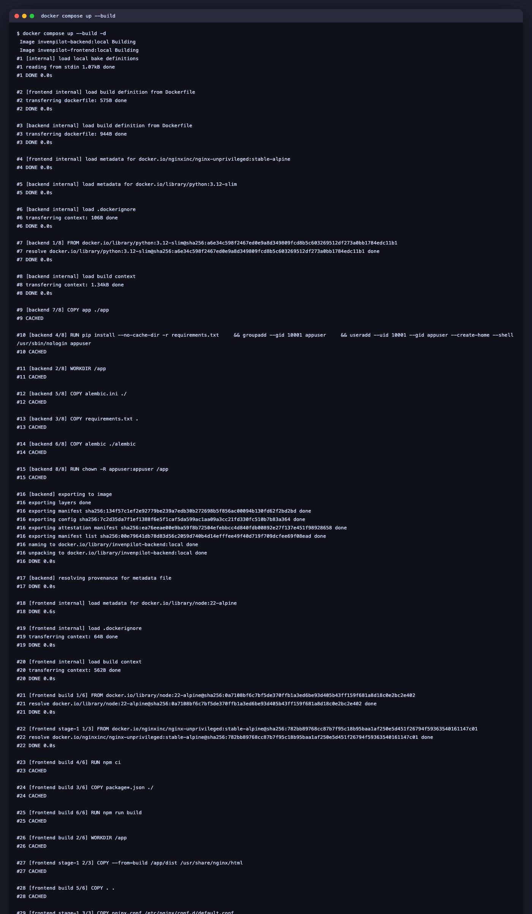<br><sub>docker compose up --build: PostgreSQL healthy, backend migrated, frontend serving on :3000</sub></p>

---

## 5. Running tests

```bash
cd backend
pip install -r requirements.txt
ruff check .
pytest -v
```

* `tests/conftest.py` spins up an **in-memory SQLite** database per test and overrides the `get_db`
  dependency, so tests never touch PostgreSQL.
* 20 tests cover `/`, `/health`, `/ready`, `/metrics`, product CRUD (201/404/409/422/204), stats
  maths, low-stock filter, stock movements and the insufficient-stock guard.
* `pytest.ini` sets `pythonpath`, `testpaths` and verbose output.

<p align="center">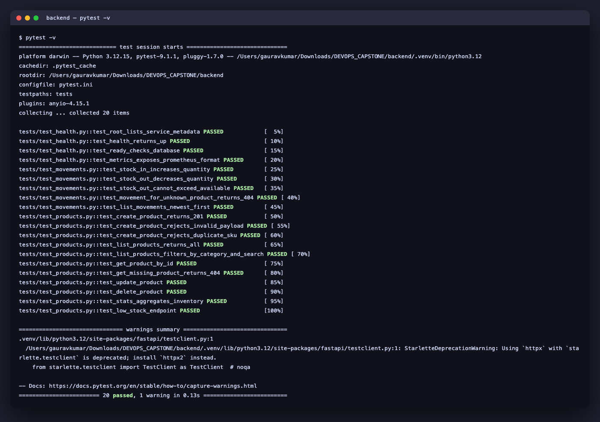<br><sub>pytest -v: 20 passed on an in-memory SQLite database</sub></p>

---

## 6. CI/CD pipeline

Workflow: [`.github/workflows/ci-cd.yml`](.github/workflows/ci-cd.yml) — runs on every push and
pull request to `main` (plus manual dispatch).

| # | Job | What it does | Gate |
|---|---|---|---|
| 1 | `backend-test` | setup-python 3.12 → `pip install` → `ruff check` → `pytest -v` | red tests fail the build |
| 2 | `frontend-build` | setup-node 22 → `npm ci` → `vite build` → upload `dist/` artifact | build error fails |
| 3 | `build-scan-push` | buildx builds both images → **Trivy** scans both → push to GHCR | HIGH/CRITICAL CVE fails; nothing is pushed unless scans pass |
| 4 | `update-gitops` | writes the new SHA into `helm/stockpilot/values.yaml` and commits `[skip ci]` | only on push to `main` |

Images are published as

```text
ghcr.io/gaurakumar-s/stockpilot-backend:<40-char git sha>
ghcr.io/gaurakumar-s/stockpilot-frontend:<40-char git sha>
```

There is deliberately **no `latest` tag**: every running pod can be traced to the exact commit that
produced it, and rollbacks are a one-line change in `values.yaml`.

Job 4 is the GitOps hand-off: the pipeline never runs `kubectl`; it changes the desired state in Git and
ArgoCD reconciles the cluster.

<p align="center">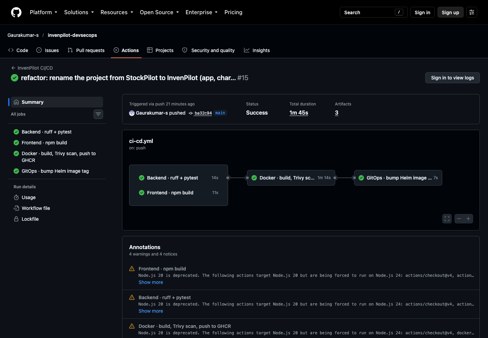<br><sub>Green GitHub Actions run: test, build, Trivy scan, GHCR push, GitOps bump</sub></p>

<p align="center">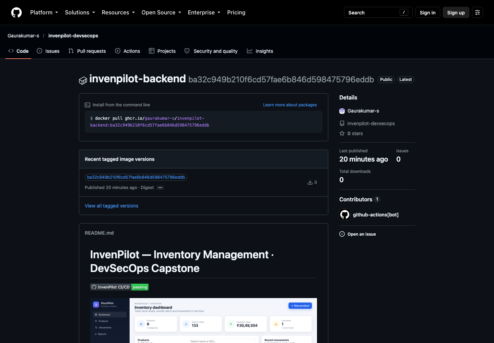<br><sub>GHCR package page: public images tagged only with commit SHAs</sub></p>

---

## 7. Security scanning (Trivy)

Trivy runs inside job 3 against **both** freshly built images with

```yaml
severity: CRITICAL,HIGH
ignore-unfixed: true
exit-code: "1"
vuln-type: os,library
```

**What Trivy scans and what the result means.** Trivy inspects every layer of the image: the OS
package database (Debian for the backend, Alpine for the frontend) and the application dependencies
(Python wheels in `site-packages`, npm packages in the build). Each package version is matched
against CVE databases. With `exit-code: 1` a HIGH or CRITICAL finding that already has a fix
available stops the pipeline before the image can reach the registry, so a vulnerable image can never
be deployed by ArgoCD.

**Finding during development.** The first local scan reported HIGH CVEs in both images:
`starlette 0.46` (CVE-2025-62727, DoS via `Range` header) in the backend, and `musl`, `zlib`,
`libxml2`, `nghttp2` in the Alpine 3.21 based Nginx image. The fix was to upgrade the Python
dependencies (`starlette 1.8`, `fastapi 0.143`) and move the frontend to `nginx-unprivileged` on
Alpine 3.24. Both images now scan clean, and the pipeline enforces that going forward.

Other hardening: both containers run as **non-root** (uid 10001 / 101), Kubernetes pods drop all
capabilities and disallow privilege escalation, `.gitignore` blocks `.env`, `*.tfstate`,
`terraform.tfvars`, and the workflow uses a least-privilege `GITHUB_TOKEN` (`packages: write` only in
the job that pushes).

<p align="center">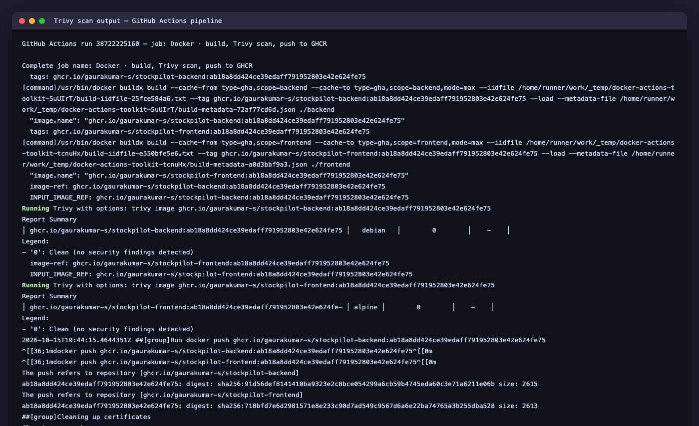<br><sub>Trivy output from the pipeline: both images clean, 0 HIGH / 0 CRITICAL</sub></p>

---

## 8. Infrastructure — Terraform on AWS

Directory: [`terraform/`](terraform/) (see its README for details).

| Resource | Configuration |
|---|---|
| Region | `ap-southeast-2` (Sydney; the only region permitted by the account's organization policy) |
| VPC | `10.20.0.0/16`, DNS hostnames enabled |
| Public subnets | `10.20.101.0/24`, `10.20.102.0/24` (AZ a/b) — tagged `kubernetes.io/role/elb` for the ingress load balancer |
| Private subnets | `10.20.1.0/24`, `10.20.2.0/24` — EKS worker nodes, egress through one NAT gateway |
| EKS | `stockpilot-eks`, Kubernetes 1.36, public API endpoint, cluster creator = admin |
| Node group | managed, `m7i-flex.large` × 2 (2 vCPU / 8 GiB each; min 2 / max 2 because the account vCPU quota is 5 and the AWS free plan only permits free-tier-eligible types), Amazon Linux 2023 |
| Add-ons | coredns, kube-proxy, vpc-cni, **aws-ebs-csi-driver** (EBS policy attached to the node role, because the account's organization policy blocks IAM OIDC providers) so PVCs bind |

```bash
cd terraform
cp terraform.tfvars.example terraform.tfvars   # optional
terraform init
terraform validate
terraform plan -out tfplan
terraform apply tfplan                           # ≈ 15 min
aws eks update-kubeconfig --region ap-southeast-2 --name stockpilot-eks
```

Tear-down (mandatory after the demo, ≈ $0.25/hour while running):

```bash
helm uninstall ingress-nginx -n ingress-nginx    # releases the AWS load balancer first
terraform destroy -auto-approve
```

No credentials are stored in the repository: Terraform reads them from the AWS CLI profile.
`terraform.tfvars.example` documents every variable.

<p align="center">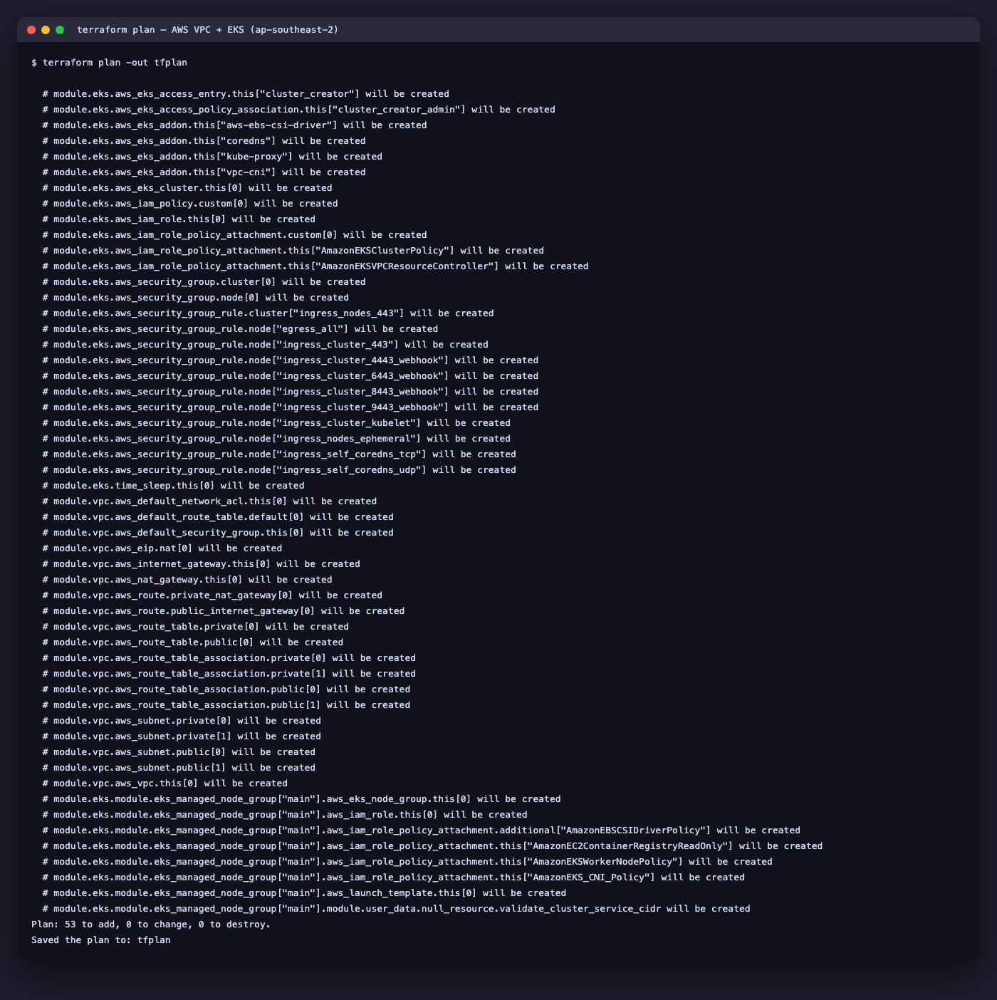<br><sub>terraform plan: 53 resources to add</sub></p>

<p align="center">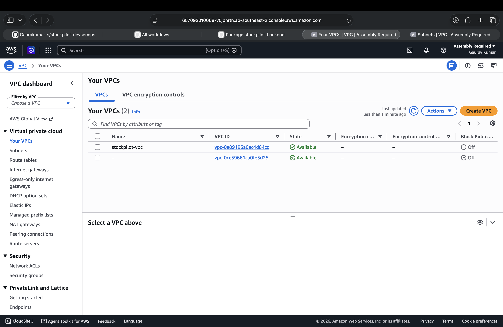<br><sub>AWS console: stockpilot-vpc in ap-southeast-2</sub></p>

<p align="center">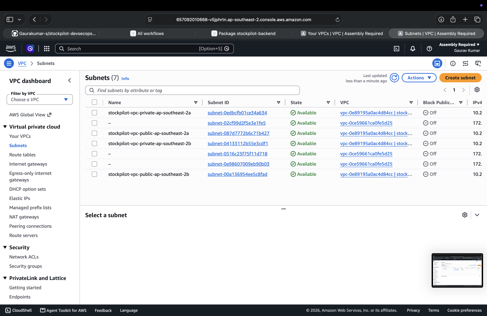<br><sub>AWS console: four stockpilot subnets across two availability zones</sub></p>

<p align="center">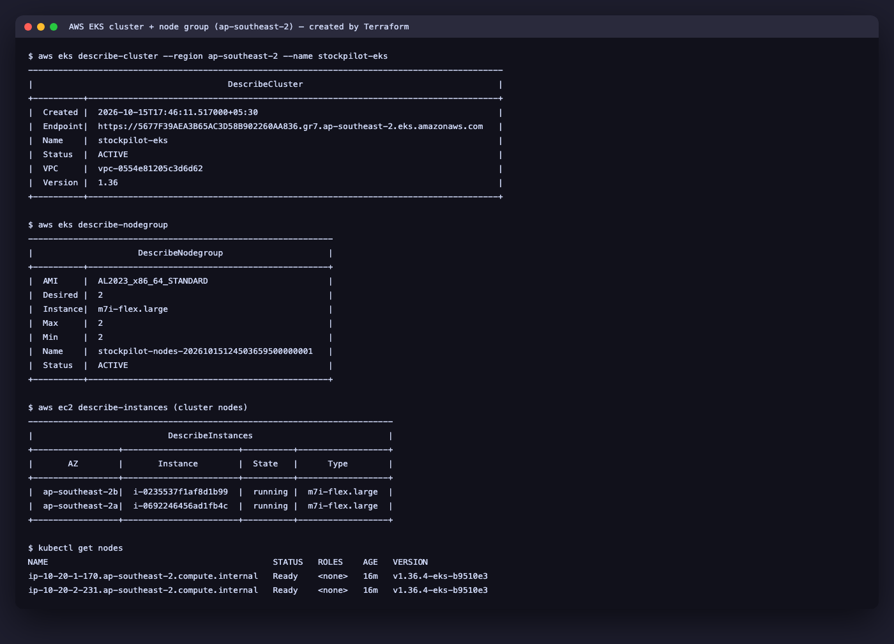<br><sub>EKS cluster, managed node group and EC2 nodes from the AWS CLI</sub></p>

<p align="center">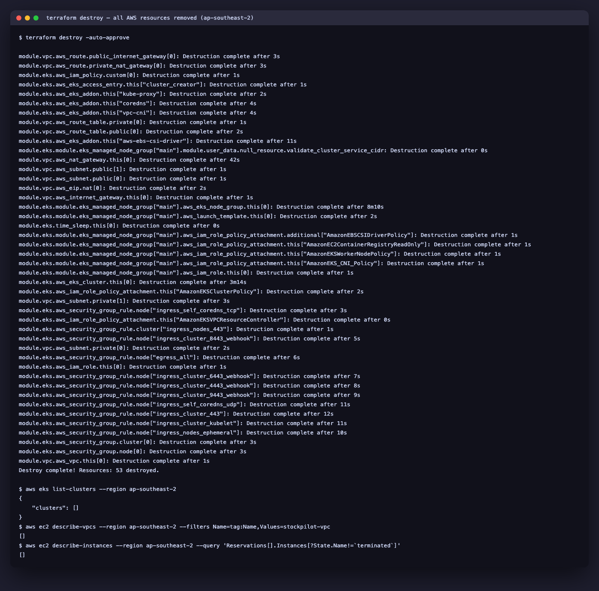<br><sub>terraform destroy: 53 resources removed, AWS checked empty</sub></p>

---

## 9. Kubernetes — Helm + ArgoCD

### Chart: `helm/stockpilot`

| Template | Resource |
|---|---|
| `backend-deployment.yaml` / `backend-service.yaml` | FastAPI Deployment (**2 replicas**, `/ready` + `/health` probes, non-root) and ClusterIP `backend:8000` |
| `frontend-deployment.yaml` / `frontend-service.yaml` | Nginx Deployment (**2 replicas**) and ClusterIP `frontend:80` |
| `postgres.yaml` | PostgreSQL Deployment + PVC + ClusterIP `postgres:5432` |
| `secret.yaml` | DB credentials + `DATABASE_URL` |
| `ingress.yaml` | `ingressClassName: nginx`; `/api` → backend, `/` → frontend |
| `hpa.yaml` | autoscaling/v2 HPA on backend CPU 60 %, 2 → 6 replicas |
| `servicemonitor.yaml` | Prometheus Operator scrape config for `/metrics` |

Values files: `values.yaml` (defaults, image tag written by CI), `values-minikube.yaml`,
`values-eks.yaml`.

### Deploy with Helm directly

```bash
kubectl apply -f k8s/namespace.yaml
helm upgrade --install stockpilot ./helm/stockpilot -n stockpilot -f helm/stockpilot/values-eks.yaml
kubectl get pods,svc,ingress,hpa -n stockpilot
helm list -n stockpilot
```

### Deploy with ArgoCD (GitOps — used in the demo)

```bash
./scripts/eks-bootstrap.sh          # ingress-nginx, metrics-server, Prometheus/Grafana, ArgoCD + Application
kubectl port-forward svc/argocd-server -n argocd 8443:443   # https://localhost:8443  (admin / printed password)
```

`argocd/application.yaml` points at `helm/stockpilot` on `main` with automated sync, prune and
self-heal. When CI commits a new image SHA, ArgoCD detects the drift and rolls the Deployments.

---

<p align="center">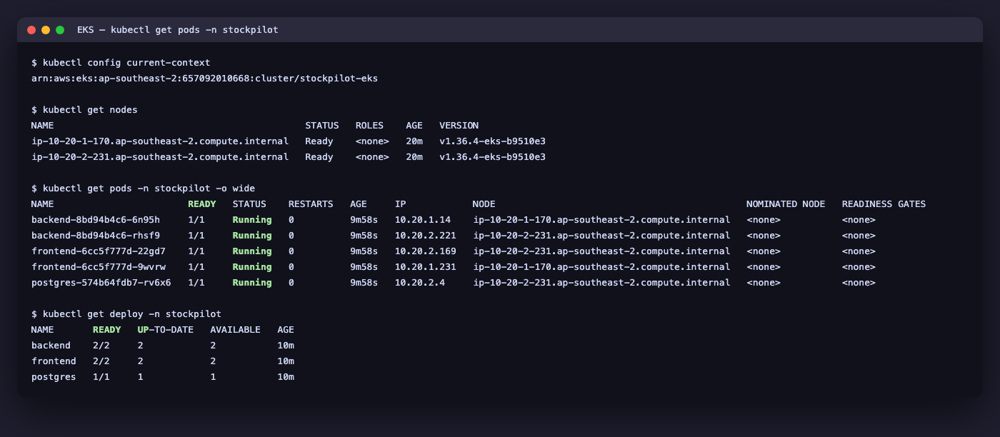<br><sub>kubectl get pods on EKS: 2 backend, 2 frontend, 1 postgres, all Running</sub></p>

<p align="center">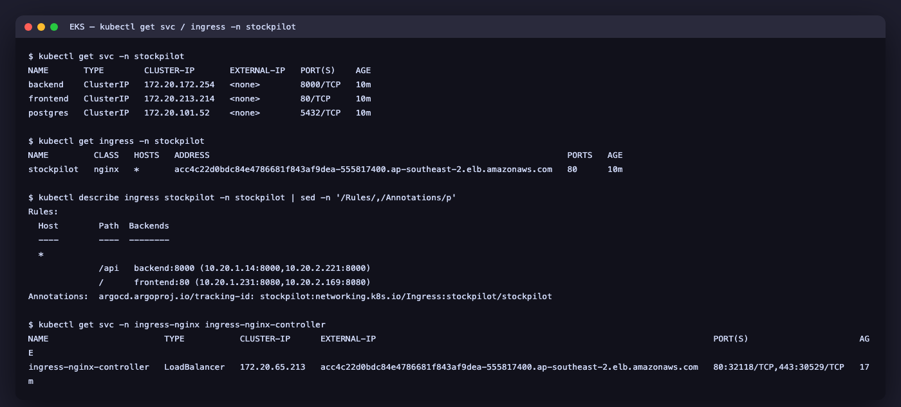<br><sub>ClusterIP services and the Ingress routing / and /api</sub></p>

<p align="center">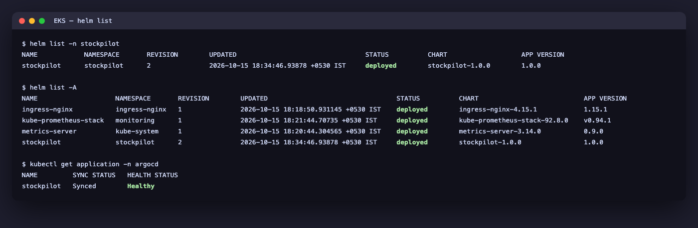<br><sub>helm list: the stockpilot release deployed</sub></p>

<p align="center">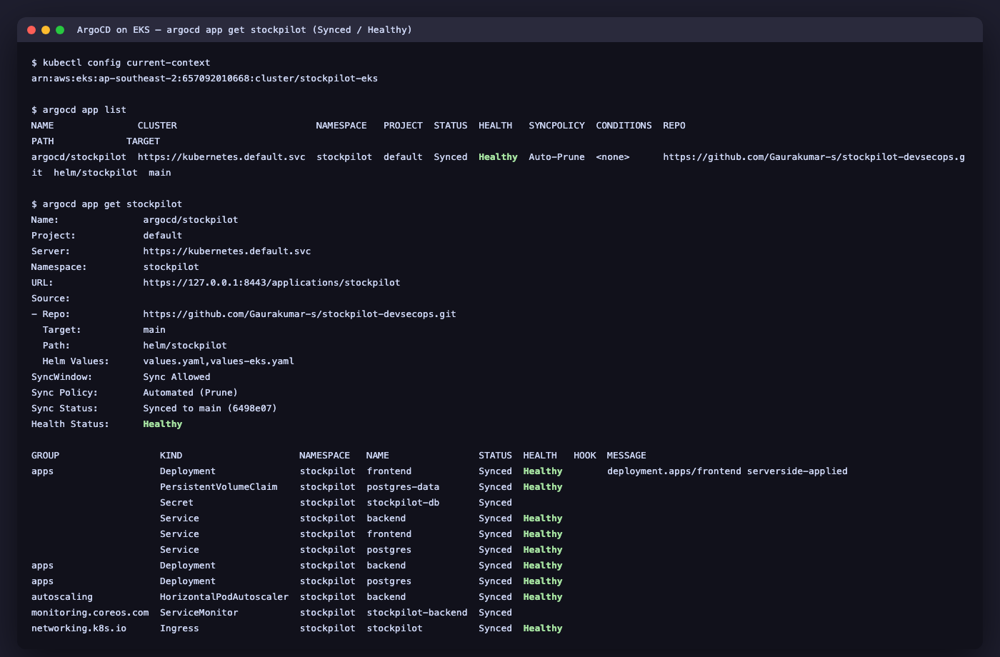<br><sub>argocd app get: Synced / Healthy with automated sync, prune and self-heal</sub></p>

---

## 10. Observability — Prometheus + Grafana

* The backend exposes Prometheus metrics at `/metrics` via `prometheus-fastapi-instrumentator`
  (`http_requests_total`, `http_request_duration_seconds`, `http_requests_inprogress`, …).
* `monitoring/install.sh` installs **kube-prometheus-stack** into the `monitoring` namespace with
  [`kube-prometheus-stack-values.yaml`](monitoring/kube-prometheus-stack-values.yaml)
  (`serviceMonitorSelectorNilUsesHelmValues: false` so it discovers the app's ServiceMonitor).
* The chart's `ServiceMonitor` (label `release: kube-prometheus-stack`) scrapes the `backend` Service
  every 15 s → the **Targets** page shows `stockpilot/stockpilot-backend` as `UP`.
* [`monitoring/grafana-dashboard.json`](monitoring/grafana-dashboard.json) is loaded by the Grafana
  sidecar (ConfigMap label `grafana_dashboard=1`) and shows: requests/sec, total requests, 5xx error
  rate, backend pods running, request rate by endpoint, p50/p95/p99 latency, responses by status code,
  backend CPU (the HPA signal).

```bash
kubectl port-forward svc/kube-prometheus-stack-prometheus -n monitoring 9090:9090   # http://localhost:9090/targets
kubectl port-forward svc/kube-prometheus-stack-grafana   -n monitoring 3001:80      # http://localhost:3001  admin / stockpilot-admin
./scripts/load-test.sh http://<ingress-host> 600                                     # populate the panels
```

<p align="center">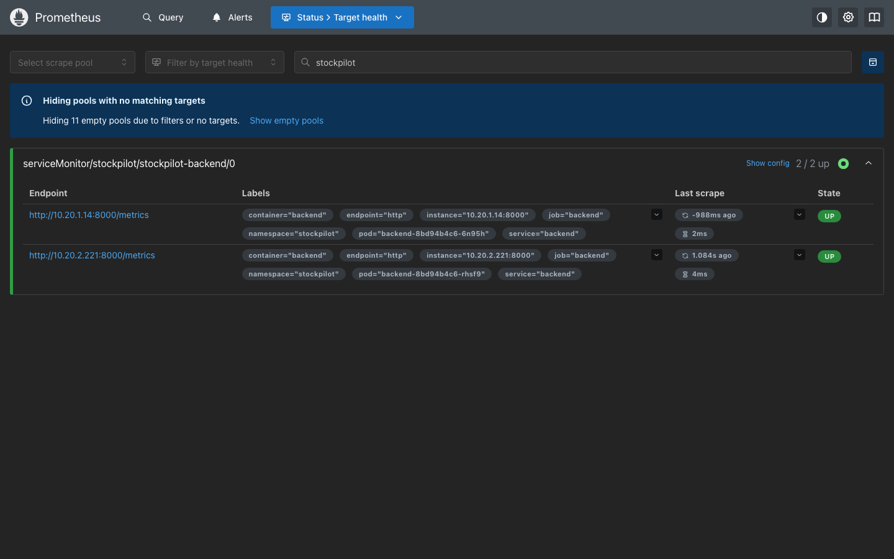<br><sub>Prometheus targets: both backend pods UP</sub></p>

<p align="center">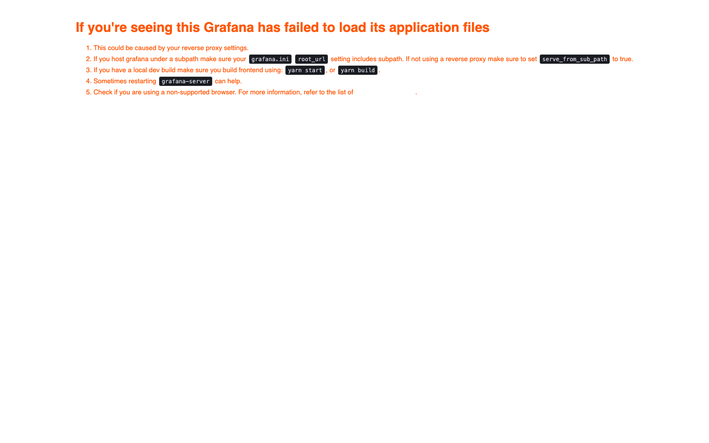<br><sub>Grafana: StockPilot application metrics with live traffic</sub></p>

---

## 11. Demo & screenshots

* `demo/slides.pptx` / `demo/slides.pdf` — presentation deck (overview, stack, architecture, CI/CD,
  security, Terraform, Kubernetes/Helm/ArgoCD, observability, learnings).
* `demo/presentation.mp4` — recorded walkthrough (slides → codebase → CI run → GHCR → Trivy → Terraform +
  AWS console → ArgoCD → kubectl → app via Ingress → Prometheus targets → Grafana).
* `docs/screenshots/` — evidence per module (app, pytest, compose, Actions, GHCR, Trivy, Terraform
  plan/apply/destroy, AWS console, kubectl, helm, ArgoCD, Prometheus, Grafana).

---

## 12. Known issues & limitations

* **PostgreSQL runs inside the cluster** (single replica + PVC). Fine for a demo; a production
  deployment would use Amazon RDS and an external secret manager instead of a Helm value.
* **Demo credentials** (`stockpilot/stockpilot`, Grafana `stockpilot-admin`) are committed on purpose
  for reproducibility; rotate them for anything real.
* **GHCR packages must be public** (or an `imagePullSecret` added to `values.yaml`) for the cluster to
  pull images.
* The Ingress has **no TLS**; cert-manager + Route 53 would be the next step.
* The HPA needs sustained CPU load to scale; use `scripts/load-test.sh` to demonstrate it.
* The EKS cluster costs money while it exists — it is created only for the demo and destroyed right
  after (`terraform destroy`).

---

**Author:** Gaurav Kumar · DevSecOps Final Capstone · October 2026
